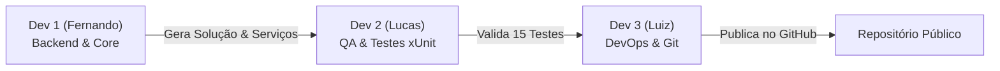

# 🎓 EduTechPlatform

> **Garantia e Gestão da Qualidade de Software**  
> **Professor:** Daniel Henrique Matos de Paiva  
> **Instituição:** Ânima Educação  

[](https://dotnet.microsoft.com/)
[](https://xunit.net/)
[](LICENSE)
[](EduTechPlatform.Tests) a

---

## 📌 1. Visão Geral da Plataforma

A **EduTechPlatform** é uma solução modular desenvolvida em **.NET 10 (C#)** voltada à gestão de regras acadêmicas e financeiras em ambientes de ensino superior e técnico. A plataforma centraliza e automatiza três domínios críticos:

1. **Desempenho Acadêmico:** Avaliação de notas por média ponderada e classificação de status acadêmico.
2. **Frequência Escolar:** Monitoramento de faltas, cálculo de assiduidade e validação de presença mínima regulamentar.
3. **Gestão Financeira & Matrícula:** Concessão automatizada de descontos em mensalidades (bolsa e pontualidade) e liberação de rematrícula com base na regularidade financeira e acadêmica.

---

## 👥 2. Divisão da Atividade em Equipe (3 Integrantes)

A lista de exercícios foi dividida igualmente entre os 3 integrantes do grupo, garantindo que cada participante assumisse a responsabilidade de um perfil técnico do projeto:

| Integrante | Papel no Projeto | Foco Principal | Tarefas Executadas |
| :--- | :--- | :--- | :--- |
| **Fernando** | **Desenvolvedor 1** | Regras de Serviço (Dev Backend / Core) | • Criação da solução e do projeto base .NET 10.<br>• Implementação de `NotaDesempenhoService.cs`.<br>• Implementação de `FrequenciaService.cs`.<br>• Implementação de `MatriculaFinanceiraService.cs`.<br>• Demonstração integrada em `Program.cs`. |
| **Lucas** | **Desenvolvedor 2** | Qualidade e Testes (QA / Testes Unitários) | • Criação e amarração do projeto `EduTechPlatform.Tests`.<br>• Implementação da suíte `NotaDesempenhoServiceTests.cs`.<br>• Implementação da suíte `FrequenciaServiceTests.cs`.<br>• Implementação da suíte `MatriculaFinanceiraServiceTests.cs`.<br>• Validação e execução de 100% dos 15 cenários de teste via `dotnet test`. |
| **Luiz** | **Desenvolvedor 3** | DevOps, Versionamento & Documentação | • Configuração do repositório Git público no GitHub.<br>• Elaboração do `.gitignore` específico para .NET 10.<br>• Inclusão da Licença MIT.<br>• Elaboração da documentação técnica e passo a passo de comandos no `README.md`. |

---

## 🏛️ 3. Estrutura da Solução

```text
edutech/
│
├── EduTechPlatform.slnx                     # Arquivo de Solução (.NET 10)
├── 26.gqs_lista_net.pdf                     # Especificação oficial da atividade
├── LICENSE                                  # Licença MIT do projeto
├── .gitignore                               # Regras de exclusão Git para .NET 10
├── README.md                                # Documentação técnica principal com comandos
│
├── EduTechPlatform.App/                     # Projeto Console / Regras de Negócio Core (Dev 1 - Fernando)
│   ├── EduTechPlatform.App.csproj
│   ├── Program.cs                           # Demonstração executável dos serviços
│   ├── NotaDesempenhoService.cs             # Regras de notas e médias ponderadas
│   ├── FrequenciaService.cs                 # Regras de presença e assiduidade
│   └── MatriculaFinanceiraService.cs        # Regras de descontos e rematrícula
│
└── EduTechPlatform.Tests/                   # Projeto de Testes Unitários xUnit (Dev 2 - Lucas)
    ├── EduTechPlatform.Tests.csproj         # Referencia EduTechPlatform.App
    ├── NotaDesempenhoServiceTests.cs        # Suíte de testes para NotaDesempenhoService
    ├── FrequenciaServiceTests.cs            # Suíte de testes para FrequenciaService
    └── MatriculaFinanceiraServiceTests.cs   # Suíte de testes para MatriculaFinanceiraService
```

---

## ⚙️ 4. Descrição das Classes de Serviço (Desenvolvedor 1 - Fernando)

### 4.1. `NotaDesempenhoService.cs`
Localizada em `EduTechPlatform.App`, encapsula o cálculo do rendimento acadêmico:
- **`CalcularMediaPonderada(decimal nota1, decimal nota2, decimal notaProjeto)`**:
  - **Pesos:** Nota 1 (peso 3), Nota 2 (peso 3), Nota Projeto (peso 4).
  - **Fórmula:** `((nota1 * 3) + (nota2 * 3) + (notaProjeto * 4)) / 10`.
- **`ObterSituacaoAcademica(decimal mediaFinal)`**:
  - `mediaFinal >= 7.0m`: Retorna `"APROVADO"`.
  - `mediaFinal >= 5.0m && < 7.0m` (5.0m a 6.99m): Retorna `"RECUPERACAO"`.
  - `mediaFinal < 5.0m`: Retorna `"REPROVADO"`.

### 4.2. `FrequenciaService.cs`
Localizada em `EduTechPlatform.App`, monitora a frequência do estudante:
- **`CalcularPorcentagemPresenca(int aulasTotais, int faltas)`**:
  - **Fórmula:** `((aulasTotais - faltas) / (double)aulasTotais) * 100`.
- **`AprovadoPorFrequencia(int aulasTotais, int faltas)`**:
  - Valida se a assiduidade é maior ou igual a **75%** (`true`). Caso contrário, retorna `false`.

### 4.3. `MatriculaFinanceiraService.cs`
Localizada em `EduTechPlatform.App`, administra as políticas financeiras e elegibilidade de matrícula:
- **`CalcularValorMensalidade(decimal valorBase, int diaPagamento, bool eBolsista)`**:
  - `eBolsista == true`: Desconto fixo de **50%** (`valorBase * 0.50m`), independentemente do dia de pagamento.
  - `eBolsista == false && diaPagamento <= 5`: Desconto de pontualidade de **10%** (`valorBase * 0.90m`).
  - `eBolsista == false && diaPagamento > 5`: Sem desconto, valor integral (`valorBase`).
- **`PodeRealizarRematricula(bool possuiPendenciaFinanceira, string situacaoAcademica)`**:
  - Permite a rematrícula (`true`) **apenas se** `possuiPendenciaFinanceira == false` **E** `situacaoAcademica != "REPROVADO"`.

---

## 🧪 5. Qualidade e Testes Unitários Parametrizados (Desenvolvedor 2 - Lucas)

A qualidade da aplicação foi assegurada por meio do framework **xUnit**, utilizando testes parametrizados com **`[Theory]`** e **`[InlineData]`**.

### 5.1. Por que utilizar `[Theory]` e `[InlineData]`?
Ao contrário de um teste estático com `[Fact]`, os testes com `[Theory]` representam suítes orientadas a dados (*data-driven tests*):
1. **Redução de Código Duplicado:** O mesmo método de teste roda múltiplas iterações variando apenas entradas e saídas esperadas.
2. **Cobertura Abrangente de Limites:** Testa com facilidade faixas de fronteira (ex.: nota 7.0 vs 6.99, pagamento dia 5 vs 6, 75% vs 74%).
3. **Rastreabilidade:** Cada linha de `[InlineData]` é tratada como um teste individual na saída do runner xUnit.

### 5.2. Mapeamento dos 15 Cenários de Teste

#### `NotaDesempenhoServiceTests.cs` (5 testes)
- **Média Ponderada:**
  - `[InlineData(7.0, 7.0, 7.0, 7.0)]`
  - `[InlineData(10.0, 10.0, 5.0, 8.0)]`
- **Situação Acadêmica:**
  - `[InlineData(8.5, "APROVADO")]`
  - `[InlineData(6.0, "RECUPERACAO")]`
  - `[InlineData(4.2, "REPROVADO")]`

#### `FrequenciaServiceTests.cs` (4 testes)
- **Cálculo de Percentual:**
  - `[InlineData(80, 20, 75.0)]` (60 presenças em 80 aulas = 75%)
  - `[InlineData(100, 10, 90.0)]` (90 presenças em 100 aulas = 90%)
- **Aprovação por Frequência:**
  - `[InlineData(80, 20, true)]` (75% presença -> Aprovado)
  - `[InlineData(80, 21, false)]` (Abaixo de 75% -> Reprovado)

#### `MatriculaFinanceiraServiceTests.cs` (6 testes)
- **Cálculo de Mensalidade:**
  - `[InlineData(1000.00, 10, true, 500.00)]` (Bolsista -> 50% de desconto)
  - `[InlineData(1000.00, 4, false, 900.00)]` (Não bolsista até dia 5 -> 10% de desconto)
  - `[InlineData(1000.00, 10, false, 1000.00)]` (Não bolsista após dia 5 -> Sem desconto)
- **Elegibilidade para Rematrícula:**
  - `[InlineData(false, "APROVADO", true)]` (Sem pendência + Aprovado -> Permite)
  - `[InlineData(true, "APROVADO", false)]` (Com pendência + Aprovado -> Bloqueia)
  - `[InlineData(false, "REPROVADO", false)]` (Sem pendência + Reprovado -> Bloqueia)

---

## 💻 6. Guia Passo a Passo de Comandos por Integrante

Abaixo estão descritos os comandos CLI executados por cada desenvolvedor de acordo com seu papel na atividade:



### 👤 6.1. Comandos do Desenvolvedor 1 (Fernando - Backend / Core)
Responsável por criar a estrutura inicial da solução, do projeto da aplicação e implementar as 3 classes de regras de negócio:

```bash
# 1. Criar a solução .NET
dotnet new sln -n EduTechPlatform

# 2. Criar o projeto de Console para a aplicação em .NET 10
dotnet new console -n EduTechPlatform.App -f net10.0

# 3. Vincular o projeto App à solução
dotnet sln add EduTechPlatform.App/EduTechPlatform.App.csproj

# 4. Compilar o projeto App para validar a ausência de erros
dotnet build EduTechPlatform.App/EduTechPlatform.App.csproj

# 5. Executar a aplicação demonstrativa
dotnet run --project EduTechPlatform.App

# 6. Registrar o commit do módulo Core no Git
git add EduTechPlatform.App/
git commit -m "feat(core): criacao e implementacao das classes de servico Nota, Frequencia e Matricula"
```

---

### 👤 6.2. Comandos do Desenvolvedor 2 (Lucas - QA / Testes Unitários)
Responsável por configurar o projeto de testes xUnit, adicionar a referência ao projeto App, criar as suítes parametrizadas e validar os 15 cenários de teste:

```bash
# 1. Criar o projeto de testes unitários xUnit em .NET 10
dotnet new xunit -n EduTechPlatform.Tests -f net10.0

# 2. Vincular o projeto de testes à solução
dotnet sln add EduTechPlatform.Tests/EduTechPlatform.Tests.csproj

# 3. Adicionar referência de dependência do projeto Tests para o projeto App
dotnet add EduTechPlatform.Tests/EduTechPlatform.Tests.csproj reference EduTechPlatform.App/EduTechPlatform.App.csproj

# 4. Executar toda a suíte de testes (15 cenários)
dotnet test

# 5. (Opcional) Executar suítes específicas individualmente:
# Apenas testes de notas:
dotnet test --filter "FullyQualifiedName~NotaDesempenhoServiceTests"
# Apenas testes de frequência:
dotnet test --filter "FullyQualifiedName~FrequenciaServiceTests"
# Apenas testes financeiros:
dotnet test --filter "FullyQualifiedName~MatriculaFinanceiraServiceTests"

# 6. Executar exibindo o relatório detalhado de cada cenário de [InlineData]
dotnet test --logger "console;verbosity=normal"

# 7. Registrar o commit das suítes de teste no Git
git add EduTechPlatform.Tests/
git commit -m "test(qa): criacao das suites xUnit com Theory e InlineData cobrindo 15 cenarios"
```

---

### 👤 6.3. Comandos do Desenvolvedor 3 (Luiz - DevOps, Versionamento & Documentação)
Responsável pelo gerenciamento do repositório remoto, configuração de ignore rules, licença MIT e documentação técnica no `README.md`:

```bash
# 1. Inicializar o repositório Git local (caso ainda não inicializado)
git init

# 2. Conectar com o repositório público no GitHub
git remote add origin https://github.com/vivoeasy100/edutech-platform-xunit.git

# 3. Criar e configurar o .gitignore específico para .NET 10 (ignorando pastas bin/ e obj/)
# (Arquivo .gitignore criado na raiz)

# 4. Criar a Licença MIT e o arquivo README.md detalhado
# (Arquivos LICENSE e README.md criados na raiz)

# 5. Adicionar arquivos ao controle de versão e realizar o commit
git add .gitignore LICENSE README.md
git commit -m "docs(devops): configuracao de gitignore, licenca MIT e documentacao detalhada no README"

# 6. Definir branch principal como main e enviar as alterações ao GitHub
git branch -M main
git push -u origin main

# Nota: Em caso de repositório remoto com histórico inicial divergente, utilize o envio forçado:
git push -u origin main --force
```

---

### ⚡ 6.4. Guia Rápido de Execução Geral (Para o Avaliador / Professor)

Para clonar e testar o projeto completo em qualquer máquina com o **.NET 10 SDK**:

```bash
# 1. Clonar o repositório
git clone https://github.com/vivoeasy100/edutech-platform-xunit.git
cd edutech-platform-xunit

# 2. Restaurar dependências
dotnet restore

# 3. Compilar a solução
dotnet build

# 4. Executar os 15 testes unitários
dotnet test

# 5. Executar a demonstração em console
dotnet run --project EduTechPlatform.App
```

---

## 👨‍💻 7. Contribuidores (Contributors 3)

| Contribuidor | Função | Responsabilidade |
| :---: | :---: | :--- |
| **Fernando** | Dev 1 | **Regras de Negócio e Serviços Core** (`EduTechPlatform.App`) |
| **Lucas** | Dev 2 | **Qualidade de Software e Testes Unitários** (`EduTechPlatform.Tests`) |
| **Luiz** | Dev 3 | **DevOps, Versionamento Git e Documentação Técnica** (`README / .gitignore`) |

---

## 📄 8. Licença

Este projeto está sob a licença [MIT](LICENSE). Consulte o arquivo de licença para obter mais detalhes.
